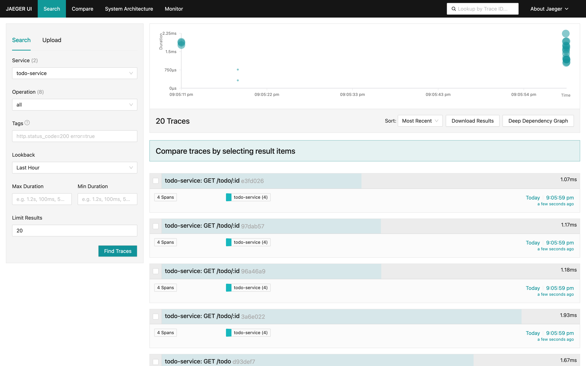
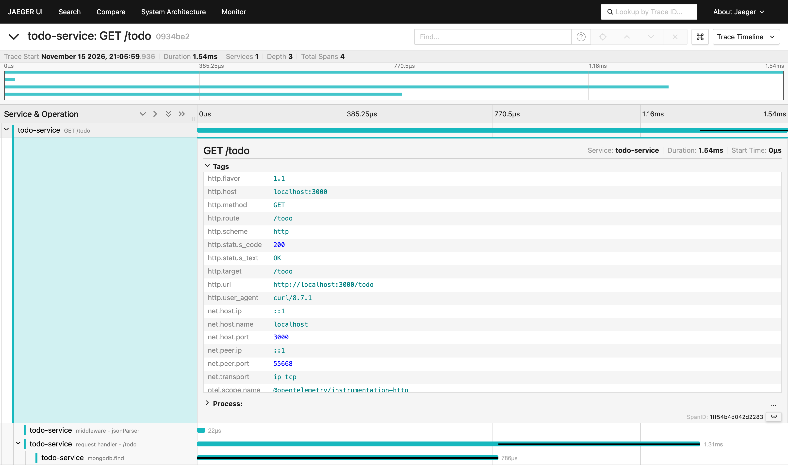
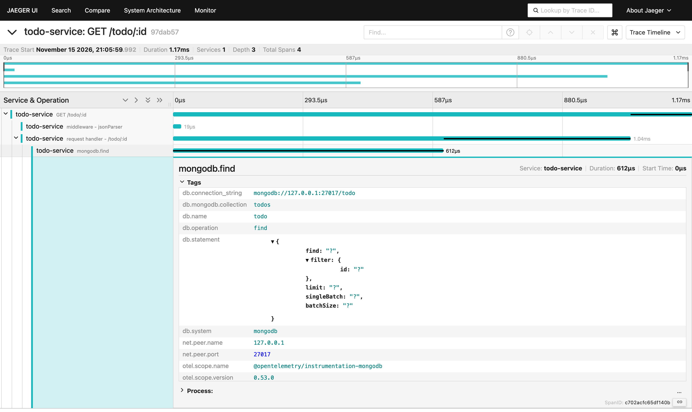
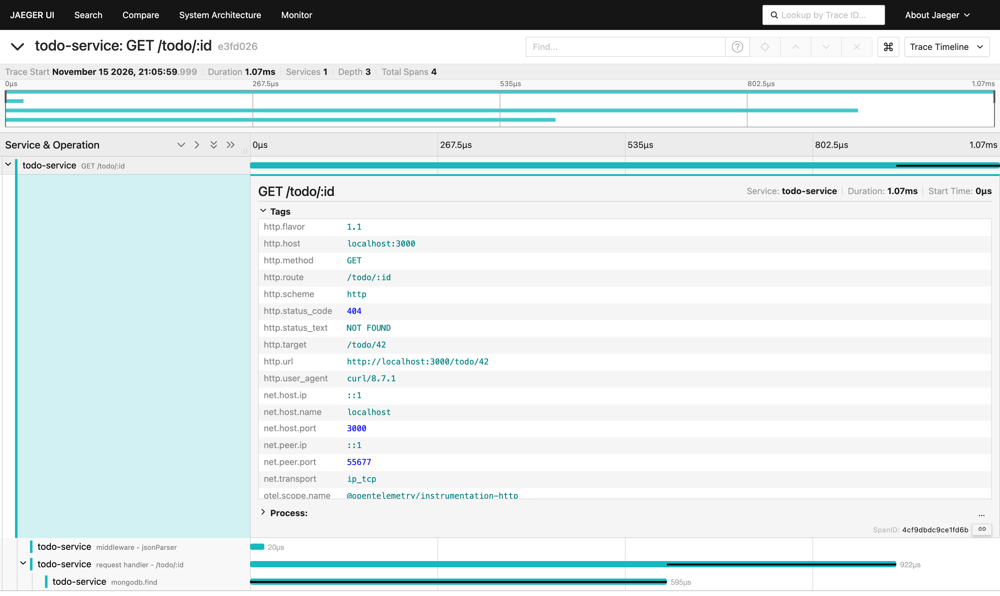

# Observability with OpenTelemetry and Jaeger

An Express + MongoDB todo service instrumented with OpenTelemetry. Traces are exported over OTLP to Jaeger.

## Run

```bash
npm install
docker run -d --name mongo -p 27017:27017 mongo
docker run -d --name jaeger \
  -p 16686:16686 -p 4317:4317 -p 4318:4318 -p 5778:5778 -p 9411:9411 \
  jaegertracing/jaeger:2.5.0
npm start   # node --require ./tracing.js index.js
```

Then send some requests and open Jaeger at http://localhost:16686 (service `todo-service`):

```bash
curl http://localhost:3000/todo
curl http://localhost:3000/todo/1
curl http://localhost:3000/todo/42   # 404
```

## Files

- `index.js`: Express server that seeds MongoDB and serves `GET /todo` and `GET /todo/:id`
- `tracing.js`: OpenTelemetry Node SDK setup. Traces go to Jaeger (OTLP/HTTP on port 4318) and metrics print to the console

Changes from the provided starter code: `tracing.js` uses the OTLP exporter and relies on `getNodeAutoInstrumentations()` alone, because it already includes the HTTP, Express and MongoDB instrumentations. `index.js` clears the seed data on startup so restarts don't create duplicates, and returns 404 for unknown ids.

## Screenshots

| Search | Request trace |
|---|---|
|  |  |
| **MongoDB span** | **404 trace** |
|  |  |
